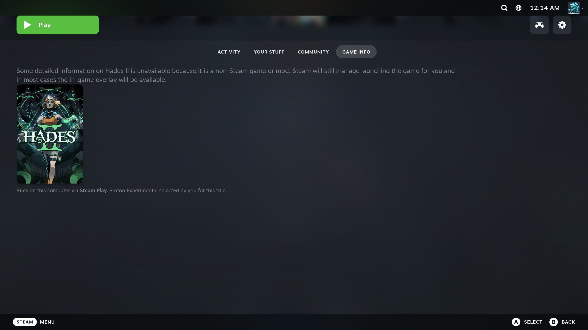
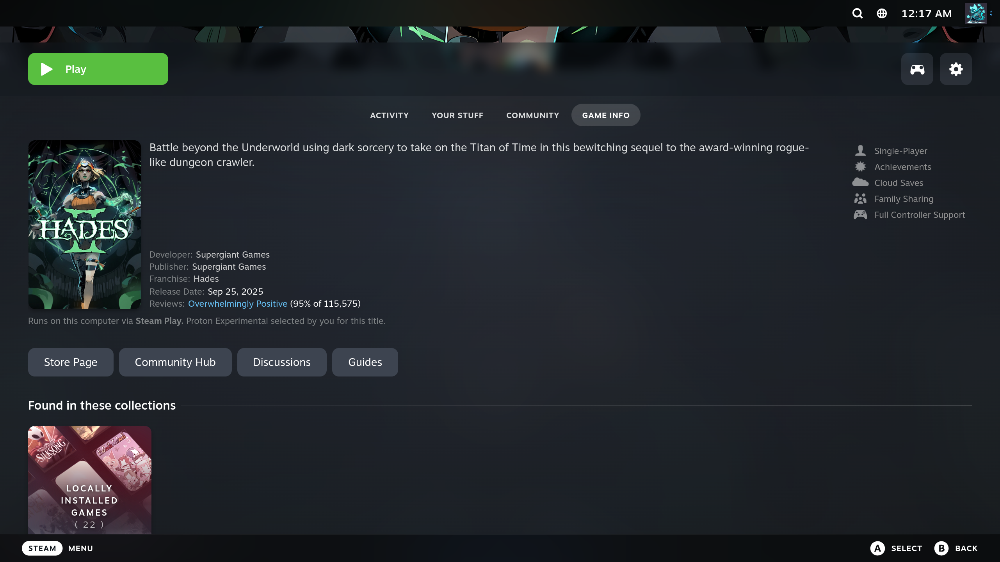
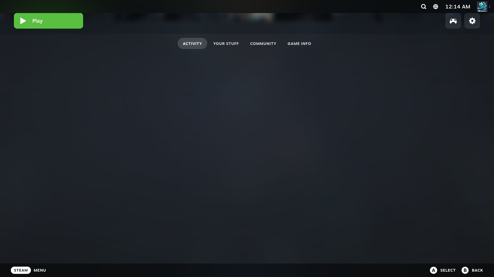
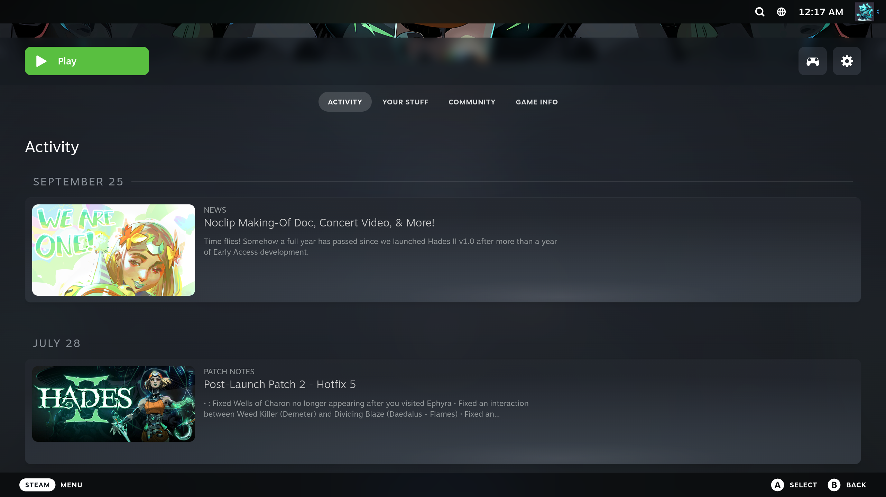

# Custom Games — a Decky Loader plugin for non-Steam games

Makes games that live outside Steam (a games folder, Anker Launcher installs) look and behave like Steam games
in Steam's Game Mode: they are found and added to the library on their own, get their official artwork at a sharp
size, and their library page shows the real game's Steam info, news, trailers and achievements.

| Game Info tab of a non-Steam game, before | … and with the plugin |
|---|---|
|  |  |

| Activity tab, before | … and with the plugin |
|---|---|
|  |  |

## Features

- **Update library** — finds new games in your games folders and in Anker Launcher's library and adds them to Steam
  while it runs (no restart): the official Steam name, Proton, the right executable and launch options.
  Runs on Steam start and from a button.
- **Steam AppID detection** — from `steam_appid.txt` and Steam-emulator configs in the game folder, from the
  emulator's save folders in the Proton prefix, else by an exact store-name match. Fixable by hand in the game page.
- **Artwork** — the game's official Steam art (portrait, wide capsule, hero, logo, icon) for new games.
- **Artwork at the right size** — every library image is kept at the size Steam shows (portrait 1200×1800,
  wide 1840×860, hero 5760×1860, logos 1000–2400 px wide): small ones are upscaled on the GPU
  ([upscayl-bin](https://github.com/upscayl/upscayl-ncnn), Real-ESRGAN, Vulkan), oversized ones scaled down.
  The plugin remembers the hash of every image, so pictures you change later (for example with the
  [SteamGridDB plugin](https://github.com/SteamGridDB/decky-steamgriddb)) are noticed and resized too.
  Images are set through Steam's own API, so they show up immediately; originals are kept in a backup folder.
- **Game page** — the native Activity / Your Stuff / Community / Game Info tabs of a non-Steam game are filled with
  the real game's data: news and patch notes, achievements, trailers (HLS playback via hls.js), screenshots,
  description, genres, reviews, Metacritic, Steam Deck rating, languages. Full gamepad navigation.
- **Achievements** — progress is read from Steam-emulator saves in the Proton prefix (GSE/Goldberg, RUNE, CODEX)
  and shown like Steam does; while a game runs, newly earned ones pop up as notifications.

Nothing from a game folder is ever executed — the plugin only reads files. Store data, news and achievement
definitions come from Steam (the client's own store cache and public, keyless Steam endpoints).

## Install

1. Install [Decky Loader](https://decky.xyz).
2. Download `custom-games-<version>.zip` from [Releases](../../releases).
3. Decky → Settings → Developer → **Install Plugin from ZIP**.

On its first start the plugin downloads the upscaler and two models (~45 MB, SHA-256 pinned) by itself; the panel
shows the progress and offers a retry. Your games folders are set in the plugin's panel (the Anker Launcher library
root is picked up automatically).

## Notes

- Tested on Ubuntu with gamescope-session, Steam Game Mode and Decky 3.3.1, AMD GPU.
- The plugin relies on Steam client internals (`SteamClient.*`, the store cache, the game page's React tree).
  A Steam update can change them; then the page simply looks as Steam draws it and nothing breaks.
- If Steam has no official image of a kind for a game (some older games have no library hero or logo), the plugin
  leaves it empty: set one with the SteamGridDB plugin and press **Check artwork now** — it gets resized.
- Not affiliated with Valve, Steam, SteamGridDB, Upscayl or Anker.

## Build

```bash
pnpm install
pnpm run typecheck
python3 tests/test_backend.py
./scripts/package.sh                 # out/custom-games.zip
./scripts/deploy.sh user@host        # build and install on a Steam machine over SSH (no sudo needed)
```

`deploy.sh` copies the ZIP to the machine and calls Decky's own installer through Steam's CEF debugger
(127.0.0.1:8080, which Decky enables), then accepts the install prompt.

## License

BSD-3-Clause (see [LICENSE](LICENSE)). Bundled: [hls.js](https://github.com/video-dev/hls.js) (Apache-2.0).
Downloaded at runtime, not part of this repository: upscayl-bin (AGPL-3.0) and Upscayl's models.
